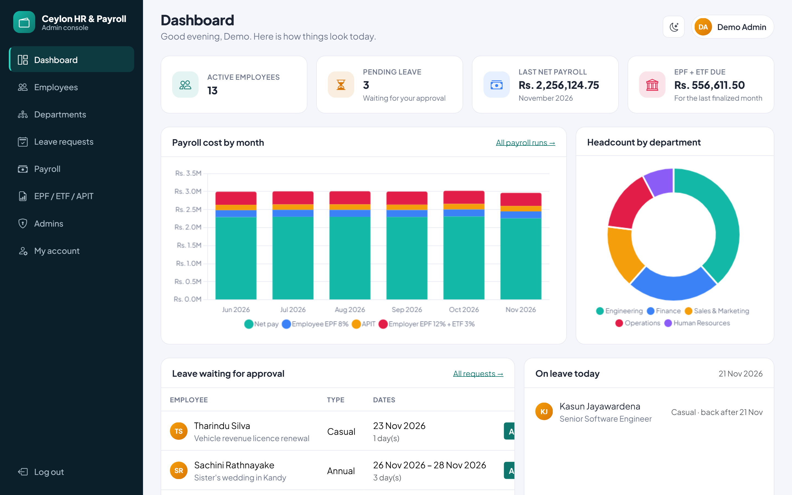
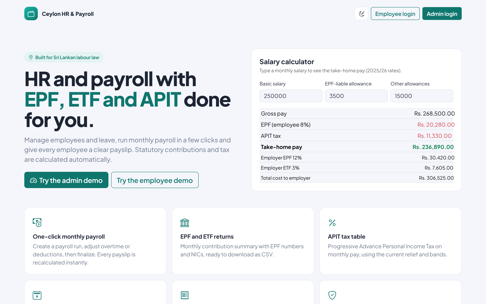
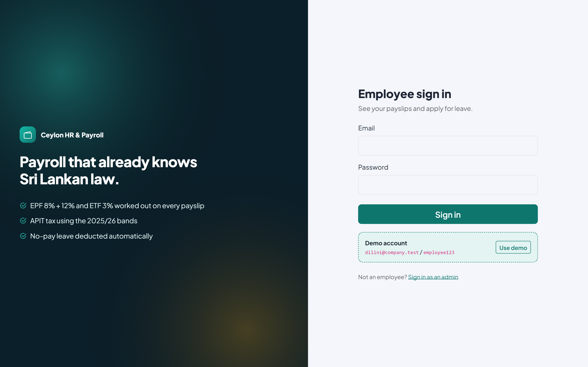
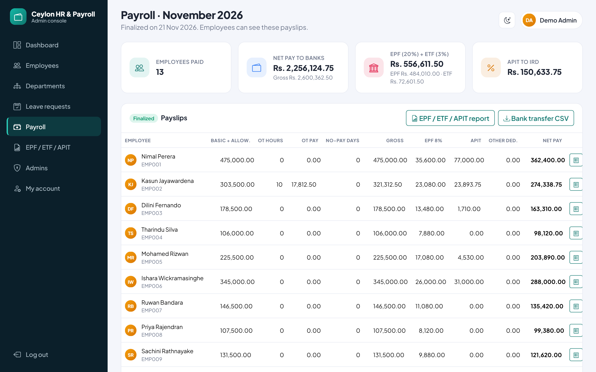
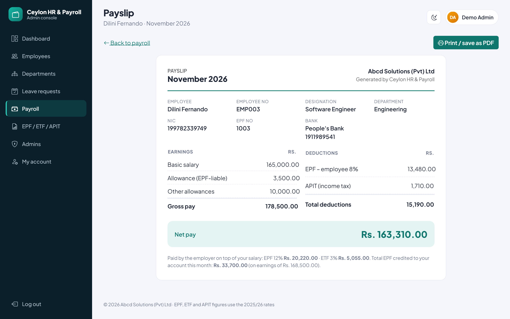
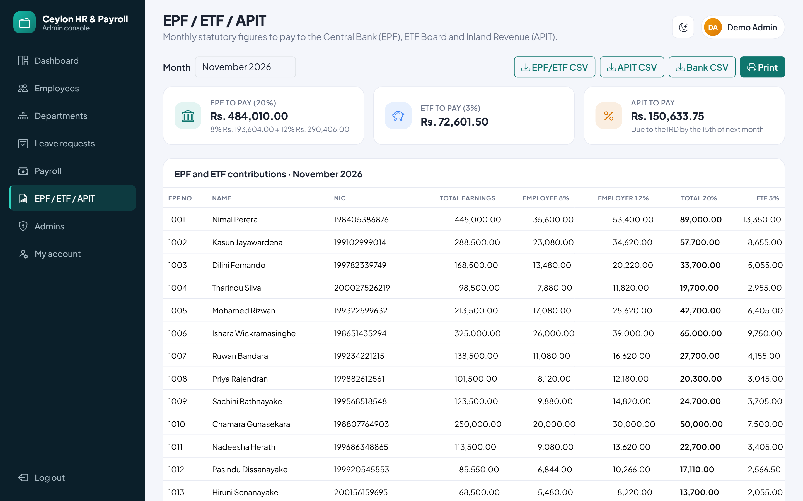
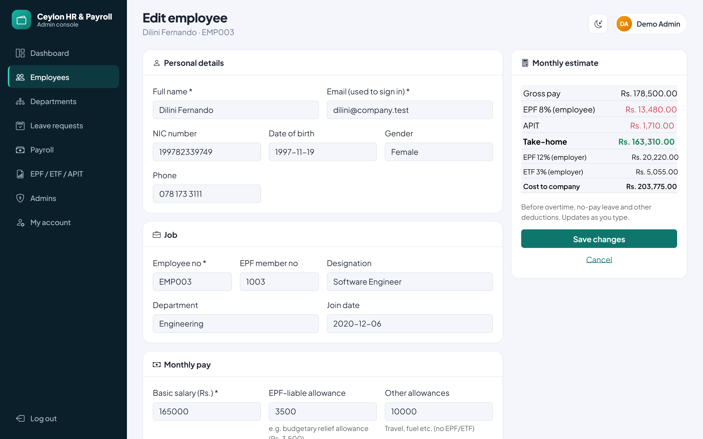
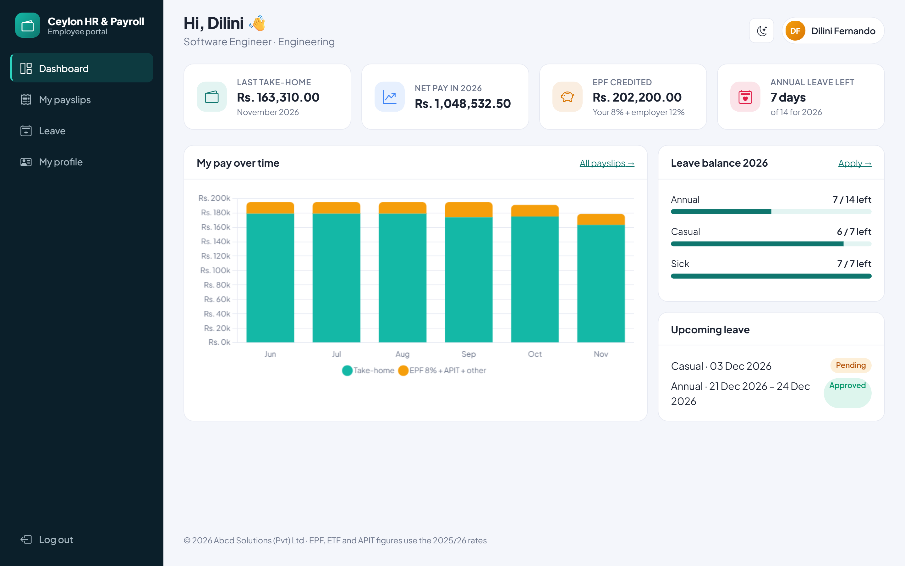
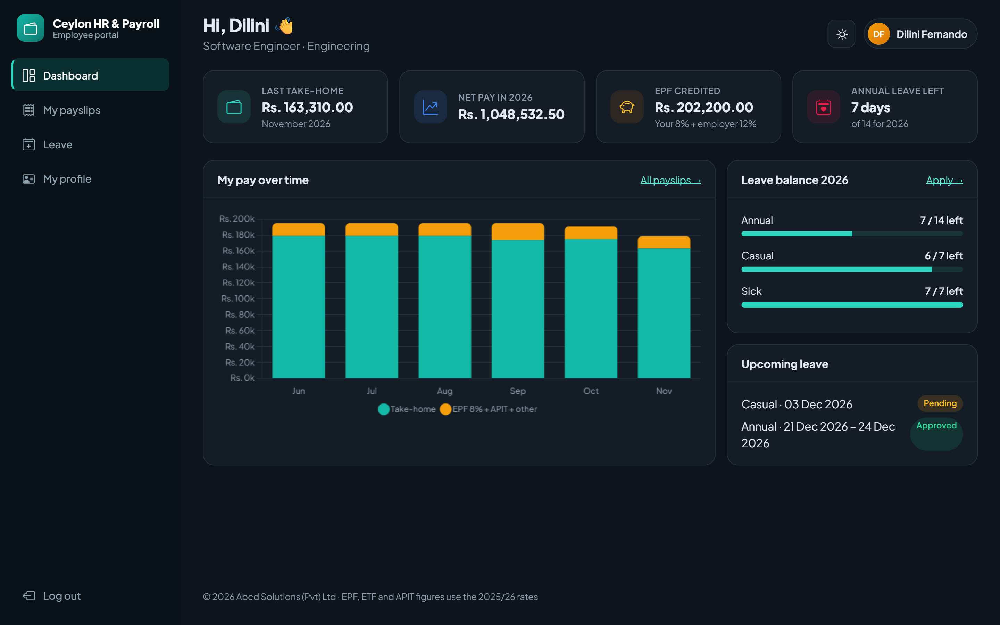

<div align="center">

# 💼 Ceylon HR & Payroll

**HR and payroll for small Sri Lankan businesses, with EPF, ETF and APIT worked out automatically.**

[**🔗 Live demo**](#-live-demo) · [Features](#-features) · [Screenshots](#-screenshots) · [Payroll rules](#-how-the-payroll-is-calculated) · [Run locally](#-run-it-locally) · [Deploy](#-deploy-your-own)




</div>

---

## 💡 Why this project?

Most employee management systems stop at "add, edit, delete". Running payroll in Sri Lanka takes much more: every month someone has to work out overtime, deduct no-pay leave, calculate **EPF** (8% + 12%), **ETF** (3%) and **APIT** income tax, produce payslips and prepare the contribution schedules.

**Ceylon HR & Payroll does all of that in a few clicks.** You create a payroll run, adjust anything that changed this month, and finalize. Every employee gets a payslip, and the statutory totals are ready to pay.

---

## 🔗 Live demo

> 🚧 **Live link coming soon.** Until then, run it locally in under a minute with SQLite ([see below](#-run-it-locally)).

| Role | Email | Password |
|---|---|---|
| 👔 Admin | `admin@company.test` | `admin123` |
| 👩‍💻 Employee | `dilini@company.test` | `employee123` |

Each login page also has a one-click **Use demo** button.

**Things to try:** run payroll for this month → add overtime hours → *Save & recalculate* → *Finalize* → open a payslip → download the EPF/ETF CSV. Then sign in as the employee to see the same payslip.

---

## ✨ Features

### 🇱🇰 Payroll built for Sri Lanka
- **One-click monthly payroll:** creates a draft payslip for every active employee. Adjust overtime, no-pay days or other deductions, recalculate, then finalize and lock it.
- **EPF and ETF:** employee 8%, employer 12% and ETF 3% on EPF-liable earnings.
- **APIT (Tax Table 01):** progressive monthly tax with the 2025/26 relief of Rs. 150,000 and the 6% → 36% bands.
- **Overtime** at 1.5 × the hourly rate (basic ÷ 240).
- **No-pay leave** is pulled into that month's payroll automatically.
- **Printable payslips:** save as PDF straight from the browser.
- **Statutory reports:** EPF/ETF contribution schedule with EPF numbers and NICs, APIT schedule and a bank transfer list, each downloadable as CSV.

### 👥 HR
- Employee records with NIC (old and new format validated), EPF number, department, designation, bank details and salary structure.
- **Live salary preview** on the employee form shows take-home pay and cost to company while you type.
- Departments with headcount and monthly salary cost.
- **Leave workflow:** annual (14 days), casual (7) and sick (7) under the Shop and Office Employees Act, plus no-pay leave. Includes balances, overlap checks, approve/reject and cancel.
- Employees with payroll history are marked **resigned** instead of deleted, so past payslips stay intact.

### 📊 Dashboards
- **Admin:** payroll cost per month (stacked by net pay, EPF, APIT and employer contributions), headcount by department, pending leave with one-click approve/reject, and who's on leave today.
- **Employee:** last take-home pay, year-to-date earnings, total EPF credited, leave balances and pay history.

### 🔒 Security
| Risk | How it's handled |
|---|---|
| SQL injection | Every query uses PDO **prepared statements** |
| Password leaks | `password_hash()` (bcrypt) + `password_verify()`, hashes upgraded automatically |
| Cross-site request forgery | **CSRF token** on every form, and all changes go through POST |
| Cross-site scripting | All output escaped with `htmlspecialchars()` |
| Session fixation / brute force | Session ID regenerated on login, HttpOnly + SameSite cookies, lockout after 5 failed logins |
| Data access | Employees can only open **their own finalized** payslips |
| CSV formula injection | Cells starting with `= + - @` are escaped |

### 🎨 Also
Dark mode · responsive layout with mobile sidebar · runs on **MySQL** or **SQLite** · Docker image · automated calculation tests

---

## 📸 Screenshots

<table>
  <tr>
    <td width="50%"><p align="center"><b>Landing page</b> with a live take-home pay calculator</p></td>
    <td width="50%"><p align="center"><b>Login</b> with one-click demo account</p></td>
  </tr>
  <tr>
    <td><p align="center"><b>Monthly payroll run:</b> edit OT, no-pay and deductions</p></td>
    <td><p align="center"><b>Payslip:</b> print or save as PDF</p></td>
  </tr>
  <tr>
    <td><p align="center"><b>EPF / ETF / APIT report</b> with CSV export</p></td>
    <td><p align="center"><b>Employee form</b> with live salary estimate</p></td>
  </tr>
  <tr>
    <td><p align="center"><b>Employee portal:</b> pay history and leave balance</p></td>
    <td><p align="center"><b>Dark mode</b></p></td>
  </tr>
</table>

---

## 🧮 How the payroll is calculated

| Item | Rule |
|---|---|
| **EPF base** | Basic salary + EPF-liable allowance − no-pay deduction |
| **EPF – employee** | 8% of the EPF base (deducted from pay) |
| **EPF – employer** | 12% of the EPF base (paid by the company) |
| **ETF – employer** | 3% of the EPF base (paid by the company) |
| **Overtime** | hours × 1.5 × (basic ÷ 240) |
| **No-pay** | days × (basic + EPF-liable allowance) ÷ 30 |
| **Gross pay** | basic + all allowances + overtime − no-pay |
| **APIT** | (gross − Rs. 150,000 relief) taxed at 6% on the first 83,333 · 18%, 24%, 30% on the next 41,667 each · 36% on the rest |
| **Net pay** | gross − EPF 8% − APIT − other deductions |

**Worked example:** a basic salary of Rs. 250,000 with a Rs. 3,500 EPF-liable allowance and Rs. 15,000 other allowances gives:

```
Gross pay           268,500.00
EPF 8%             − 20,280.00   (8% of 253,500)
APIT               − 11,330.00   (6% × 83,333 + 18% × 35,167)
Take-home pay       236,890.00
Employer EPF 12%     30,420.00
Employer ETF 3%       7,605.00
Cost to company     306,525.00
```

All rates are in one function, `payroll_rates()` in [`includes/payroll.php`](includes/payroll.php), so a budget change is a one-line update. The calculations are covered by tests:

```bash
php tests/payroll_test.php
# All 20 checks passed.
```

> ⚠️ Tax bands change with each national budget. Check the latest [IRD APIT tables](https://www.ird.gov.lk) before using this for real payroll.

---

## 🛠 Tech stack

| Layer | Technology |
|---|---|
| Backend | PHP 8 (no framework), PDO |
| Database | MySQL / MariaDB or SQLite |
| Frontend | Bootstrap 5.3, Bootstrap Icons, Chart.js 4, vanilla JS |
| Hosting | Docker (Apache) on Render, or any PHP host |

---

## 💻 Run it locally

### Option A: SQLite (no database server needed)
```bash
git clone https://github.com/SasmithaTharushan/employeeManagementSys.git
cd employeeManagementSys
DB_DRIVER=sqlite php -S localhost:8000
```
On Windows PowerShell:
```powershell
$env:DB_DRIVER="sqlite"; php -S localhost:8000
```
Open http://localhost:8000. The database and demo data are created on the first request.

### Option B: XAMPP / MySQL
1. Copy the folder into `C:\xampp\htdocs\`.
2. In phpMyAdmin, create a database called `employee_management`.
3. Open http://localhost/employeeManagementSys/install.php and click **Install**.
4. Delete `install.php` afterwards.

### Configuration
Settings come from environment variables, or from a git-ignored `config.local.php`:

| Variable | Default | Purpose |
|---|---|---|
| `DB_DRIVER` | `mysql` | `mysql` or `sqlite` |
| `DB_HOST` / `DB_PORT` | `127.0.0.1` / `3306` | MySQL server |
| `DB_NAME` | `employee_management` | Database name |
| `DB_USER` / `DB_PASS` | `root` / *(empty)* | MySQL login |
| `DEMO_MODE` | `1` | Set to `0` to hide the demo logins |
| `COMPANY_NAME` | `Abcd Solutions (Pvt) Ltd` | Shown on payslips |

```php
<?php // config.local.php
return ['db' => ['driver' => 'mysql', 'user' => 'root', 'pass' => 'secret']];
```

---

## 🚀 Deploy your own

### Free PHP hosting with MySQL (e.g. InfinityFree), no card needed
1. Create a free hosting account and a MySQL database in the control panel.
2. Upload the app files into `htdocs` (you don't need `tests/`, `docs/`, `Dockerfile` or `render.yaml`).
3. Create `config.local.php` next to `index.php` with your database details:
   ```php
   <?php return ['db' => [
       'driver' => 'mysql', 'host' => 'sqlXXX.infinityfree.com',
       'name' => 'if0_XXXXXXXX_payroll', 'user' => 'if0_XXXXXXXX', 'pass' => 'your-password',
   ]];
   ```
4. Open `https://your-site/install.php`, click **Install**, then delete `install.php`.

### Docker (Render, Railway, Fly.io…)

[](https://render.com/deploy?repo=https://github.com/SasmithaTharushan/employeeManagementSys)

The `Dockerfile` runs PHP 8.3 + Apache with SQLite and demo data, so there's no database to set up. The `render.yaml` blueprint deploys it to Render's free plan in one click. Render asks for a card to verify your identity, even on the free plan. Free instances sleep when idle, and demo data resets on restart.

> GitHub Pages and Vercel only host static sites and serverless functions, so they can't run this PHP + database app.

---

## 📁 Project structure

```
├── index.php                Landing page with live salary calculator
├── install.php              One-time MySQL installer
├── config.php               Settings (overridable with env vars)
├── includes/
│   ├── bootstrap.php        Loads config, session and helpers
│   ├── db.php               PDO connection + query helpers
│   ├── auth.php             Login, logout, throttling, passwords
│   ├── payroll.php          EPF / ETF / APIT engine and payroll runs
│   ├── payslip_view.php     Payslip template
│   └── layout.php           Page shell, sidebar, login page
├── admin/                   Admin console (employees, leave, payroll, reports)
├── employee/                Employee portal (dashboard, payslips, leave, profile)
├── database/setup.php       Schema for MySQL + SQLite, and demo data
├── assets/                  CSS and JavaScript
├── tests/payroll_test.php   Payroll calculation tests
├── Dockerfile               PHP 8.3 + Apache image
└── render.yaml              Render blueprint
```

---

## 🗺 Roadmap

- [ ] Gratuity calculation (half a month's salary per year after 5 years of service)
- [ ] Email payslips to employees
- [ ] Public holiday calendar (Poya and mercantile holidays)
- [ ] QR code attendance with automatic overtime
- [ ] Audit log of every change

---

<div align="center">

Built by **[Sasmitha Tharushan](https://github.com/SasmithaTharushan)**. If this project helped you, consider giving it a ⭐

</div>
